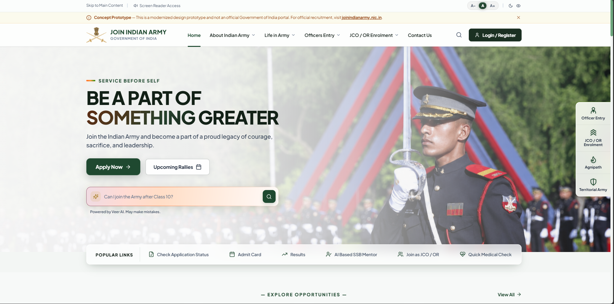
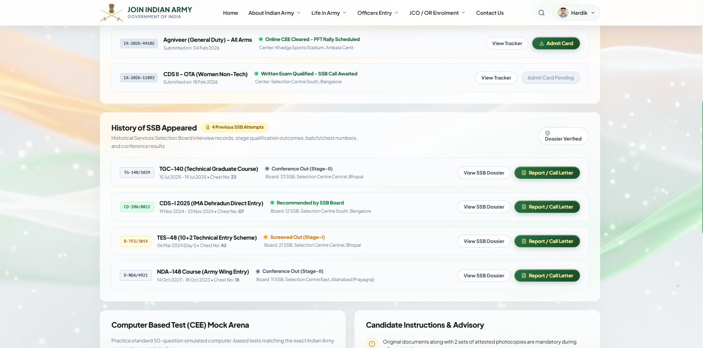
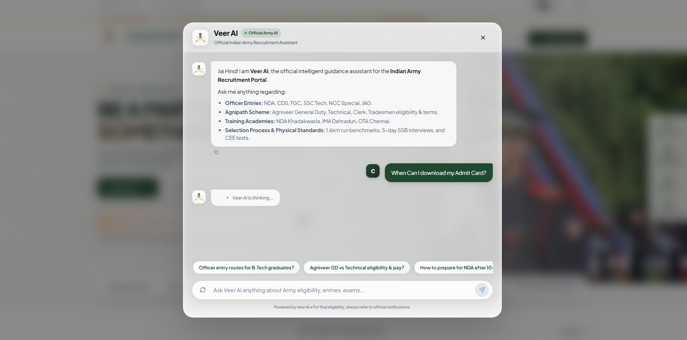
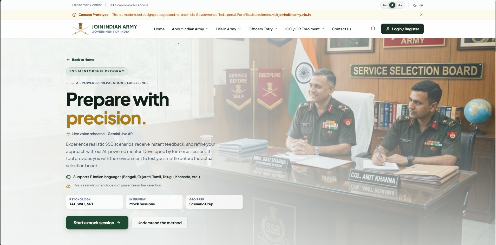
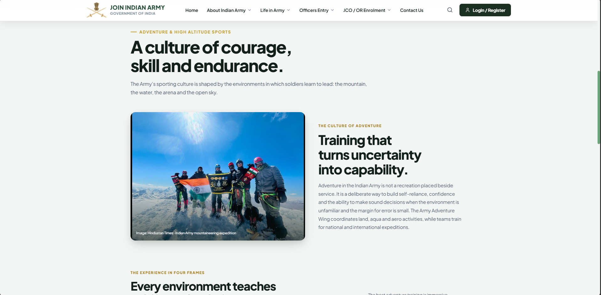

# 🇮🇳 Indian Army – Website Redesign

A modern, AI-powered redesign of the Indian Army's digital platform, focused on transforming the recruitment experience through intuitive UI/UX, intelligent assistance, and centralized services.

---

## ✨ Key Features

- **AI-Based SSB Mentorship:** An intelligent AI-powered mentorship experience designed to guide aspirants through SSB preparation, interview practice, and personalized assistance.
- **Unified Dashboard:** A centralized dashboard bringing recruitment updates, applications, notifications, and essential information together in one place.
- **AI-Powered Chatbot:** An interactive conversational assistant that helps users explore website features and find relevant recruitment information.
- **Gemini AI Integration:** Integrates Google's Gemini API to enable intelligent responses, AI-driven assistance, and smarter user interactions.
- **Modern UI/UX:** A clean, responsive, and intuitive interface designed to make navigation seamless across devices.
- **Recruitment Portal:** Dedicated sections for Officer Entries, JCO/OR Enrolment, and Agniveer recruitment.
- **Information Hub:** Easy access to eligibility criteria, academies, rallies, important dates, and examination results.
- **Articles & Updates:** A dedicated information section featuring articles and recruitment-related updates.

---

## 📸 Website Preview

### 🏠 01. Homepage
The redesigned landing page introduces a modern visual identity with intuitive navigation, prominent recruitment information, and quick access to important sections of the Indian Army portal.

---

### 📊 02. Unified Dashboard
A centralized interface that brings essential recruitment information, application-related updates, and important resources together for a more organized user experience.

---

### 🤖 03. AI-Powered Chatbot
An interactive AI assistant designed to help visitors navigate the platform, ask questions, and discover relevant recruitment information through natural conversations.

---

### 🧠 04. AI-Based Features
AI-driven capabilities, including SSB mentorship and intelligent assistance, designed to support aspirants with interview preparation and a more personalized digital experience.

---

### 📰 05. Articles & Updates
A dedicated content section that presents important articles, announcements, and useful information in an organized and accessible format.

---

## 🛠️ Tech Stack

| Technology | Purpose |
|---|---|
| React.js | Frontend development |
| JavaScript | Application logic |
| CSS | Styling and responsive UI |
| Google Gemini API | AI-powered features |
| Vite | Development and build tool |
| Netlify | Deployment |

---

## 🎯 Project Objective

To reimagine the Indian Army's digital experience by bringing recruitment services, AI-powered mentorship, and essential information together in a modern, accessible platform.

## 🔗 Live Demo

**[🚀 Explore the Redesigned Indian Army Website](https://joinindianarmy.netlify.app/)**

---

## ⚠️ Disclaimer

This is an independent redesign project developed for educational and demonstration purposes. It is not an official website and is not affiliated with, endorsed by, or associated with the Indian Army or the Government of India.

---

  <b>🇮🇳 Built with passion | Designed for a smarter digital experience.</b>

